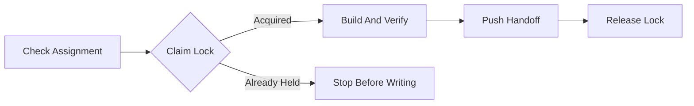

# One Writer Per Work Order

*AI Dev Shop Reliability Case Study*

Ryan Walters · November 2026

## Executive Summary

I coordinate AI-assisted development through work orders tracked in Git. During a native build, two sessions started the same order in one worktree. Both reported passing checks and pushed handoffs with different artifact hashes. I added a lock to establish ownership before execution.

## Business Impact

The duplicate build consumed model capacity and build time twice. I reconciled both handoffs into one accepted host-build result. Git kept both handoffs as evidence. Hardware deployment still required a fresh hash of the selected package.

## Root Cause

The existing check confirmed that the work order was current and eligible. Both sessions read the same valid state before either recorded a change.

## Ownership Control

The helper claims the work order by creating a directory atomically in the current worktree’s Git administrative storage. One session at a time can hold the lock for a given work order and writer role. A session that loses the claim must stop before editing, building, or running tests that write artifacts. The owner verifies the work, commits and pushes the handoff, and confirms a clean worktree before releasing the lock. [Git Worktree Reference](https://git-scm.com/docs/git-worktree#_details) · [POSIX Mkdir Reference](https://man7.org/linux/man-pages/man3/mkdir.3p.html)

## Verification Results

The original fix is committed. I tested it alongside a local hardening candidate in disposable Git worktrees. The candidate keeps ownership tokens out of diagnostics and protects the next owner’s lock from late release attempts.

| Verification Test | Observed Result |
| --- | --- |
| Committed Lock | Exactly one owner acquired the lock in each of 10 rounds of 20 competing claims. |
| Local Hardening Candidate | Exactly one owner acquired the lock in each of 25 rounds of 20 competing claims. |
| Ownership Handoffs | The successor retained its lock in all 30 handoffs. Each handoff tested eight competing release attempts. |

The candidate also released a lock created by the earlier helper. It kept a lock held after the owner exited. Two linked worktrees could hold the same work-order key independently.

## Recovery Policy

If an owner exits before handoff, the lock stays in place. A human inspects the worktree before clearing a stale lock. Planned parallel work uses separate worktrees and work orders.

## Operating Scope

The results cover cooperating sessions in a single local worktree. Across machines, I would use a tested coordinator. The system accepting artifacts would also need a way to reject writes from a former owner. [AWS Leader Election Guide](https://aws.amazon.com/builders-library/leader-election-in-distributed-systems/)

## Success Measures

I count duplicate executions in the cost of an accepted work order. I plan to track rejected claims, time spent recovering stale locks, and model and build effort per accepted order. Incident recurrence and cost savings remain unmeasured. [Google SRE Postmortem Guide](https://sre.google/workbook/postmortem-culture/) · [SREcon Incident Metrics Talk](https://www.usenix.org/conference/srecon22americas/presentation/nash)

## Case Study Downloads

[Case Study PDF](case-study.pdf) · [Verification Summary](verification.md)
